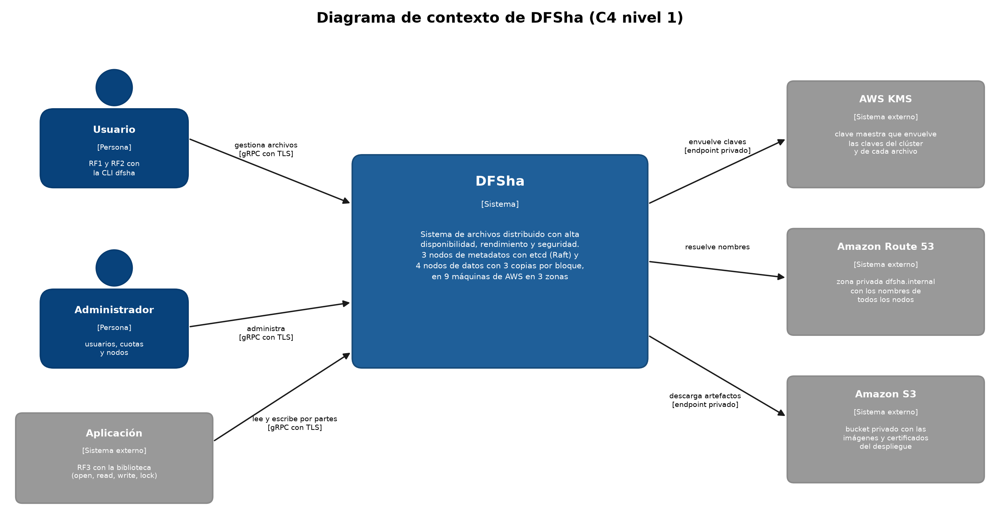
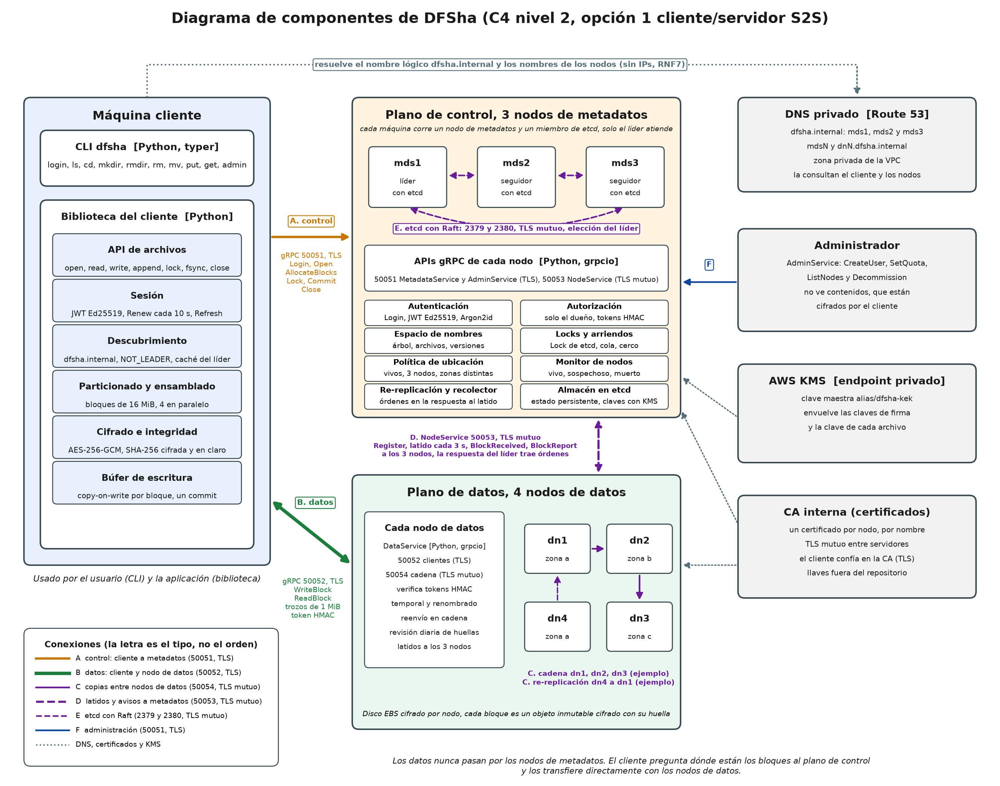
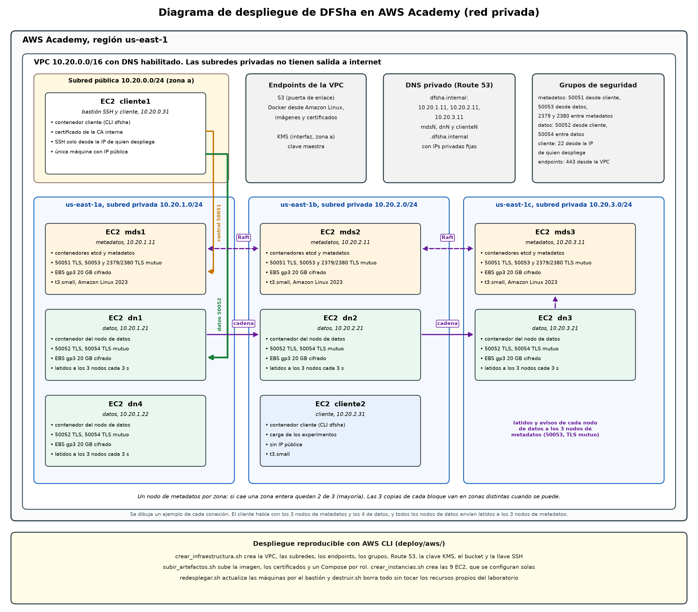

# Arquitectura de DFSha

DFSha sigue la opción 1 del enunciado, cliente/servidor con un servicio distribuido entre servidores (S2S) dentro de una red privada. Hay dos planos.

- **Plano de control.** Tres nodos de metadatos, cada uno junto a un miembro de etcd. etcd replica el estado con Raft y el nodo que gana la elección es el líder, que atiende a los clientes (D1).
- **Plano de datos.** Cuatro nodos de datos guardan los bloques cifrados de 16 MiB, con tres copias por bloque escritas en cadena (D5). Los datos nunca pasan por los nodos de metadatos.

Los diagramas se generan con los scripts de [docs/diagramas/](diagramas/), que también tiene los casos de uso, las secuencias y los escenarios.

## Contexto (C4 nivel 1)

## Componentes (C4 nivel 2)

| Conexión | Entre | Puerto y protección | Para qué |
|---|---|---|---|
| A | Cliente y nodo de metadatos líder | 50051, TLS | Sesión, espacio de nombres, Open, AllocateBlocks, Lock, Commit y Close |
| B | Cliente y nodos de datos | 50052, TLS | WriteBlock y ReadBlock con token HMAC por bloque |
| C | Nodos de datos entre sí | 50054, TLS mutuo | Escritura en cadena y copias de re-replicación |
| D | Nodos de datos y los 3 nodos de metadatos | 50053, TLS mutuo | Register, latidos, BlockReceived, BlockDeleted e inventario. La respuesta del líder trae órdenes |
| E | Nodos de metadatos y etcd, y miembros de etcd entre sí | 2379 y 2380, TLS mutuo | Transacciones, leases, Lock, Election y replicación Raft |
| F | Administrador y nodo de metadatos líder | 50051, TLS | AdminService |

| Componente | Responsabilidad | Código |
|---|---|---|
| Cliente | CLI (RF1 y RF2) y biblioteca (RF3). Descubre al líder, cifra cada bloque, lo envía en paralelo y verifica las huellas | `dfsha/client/` |
| Nodo de metadatos | Autenticación, espacio de nombres, apertura, locks, commit, ubicación de bloques, recuperación y administración. Solo el líder atiende | `dfsha/metadata/` |
| etcd | Estado persistente del plano de control con consenso Raft | imagen oficial v3.5.35 |
| Nodo de datos | Guarda bloques cifrados, verifica su huella, reenvía en cadena, avisa a los nodos de metadatos y ejecuta sus órdenes | `dfsha/datanode/` |

## Despliegue en AWS (D10)

- **Máquinas.** 9 EC2 t3.small con Amazon Linux 2023, disco gp3 cifrado y LabInstanceProfile. Cada una corre un Docker Compose de su rol (`deploy/aws/compose/`).
- **Red.** Las subredes privadas no tienen salida a internet. Docker se instala desde los repositorios de Amazon Linux y las imágenes llegan de un bucket privado, ambos por el endpoint de S3. KMS se alcanza por su endpoint de interfaz (A13).
- **Nombres.** Zona privada de Route 53 `dfsha.internal`. El nombre lógico resuelve a los 3 nodos de metadatos y cada nodo tiene su nombre. El cliente no conoce ninguna IP (RNF7, D7).
- **Grupos de seguridad.** Los clientes alcanzan solo 50051 y 50052. Los puertos 50053, 50054, 2379 y 2380 solo se abren entre servidores, que además usan TLS mutuo.
- **Scripts.** `deploy/aws/` crea, despliega, actualiza y borra todo con AWS CLI ([deploy/aws/README.md](../deploy/aws/README.md)).

## Flujo de una escritura

1. El cliente abre el archivo en el líder (Open), que le entrega la clave del archivo y, en modo escritura, el lock del archivo entero.
2. Pide bloques nuevos (AllocateBlocks). El líder asigna ids y una cadena de 3 nodos de datos en zonas distintas, con un token de escritura por bloque.
3. El cliente cifra cada bloque con AES-256-GCM y lo envía en trozos de 1 MiB al primer nodo, que lo reenvía al segundo y este al tercero mientras lo reciben.
4. Cada nodo verifica la huella de su copia, la guarda y avisa a los 3 nodos de metadatos con BlockReceived. El bloque cuenta como escrito con 2 copias.
5. El cliente confirma con Commit. El líder comprueba los avisos, los locks y la versión base, y publica el manifiesto nuevo en una sola transacción de etcd. Ese es el único punto de commit.

El paso a paso de cada operación está en las secuencias de [docs/diagramas/](diagramas/), la semántica y las garantías en [docs/semantica.md](semantica.md), la seguridad en [docs/seguridad.md](seguridad.md) y cada decisión con su justificación en [docs/decisiones.md](decisiones.md).
