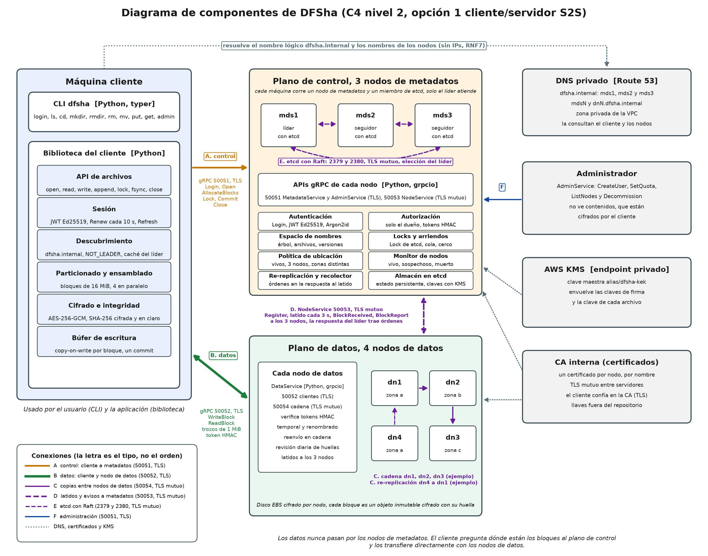
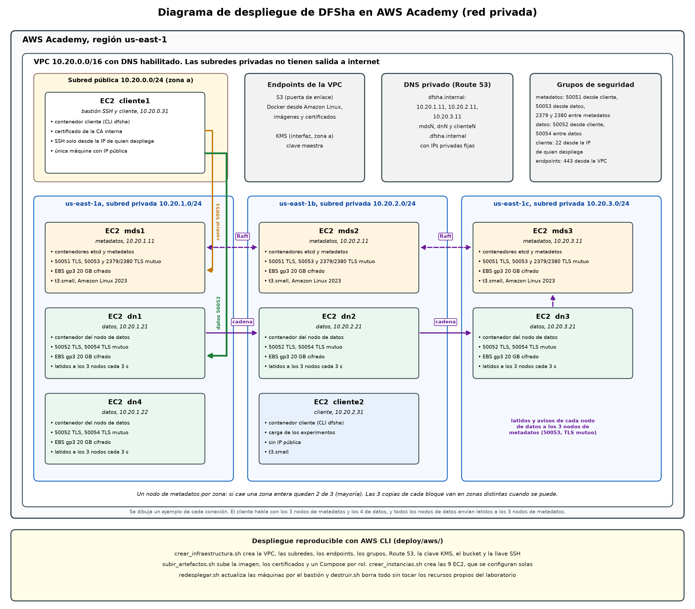

# Diagramas

Los diagramas se generan con dos scripts de matplotlib, que son su fuente (D12). Son los de la Fase I actualizados con lo implementado.

```
pip install matplotlib
python docs/diagramas/generar_arquitectura.py   # contexto, componentes y despliegue
python docs/diagramas/generar_uml.py            # casos de uso, secuencias y escenarios
```

## Arquitectura

| Diagrama | Contenido |
|---|---|
| [Contexto (C4 nivel 1)](contexto.png) | DFSha, sus usuarios y los servicios de AWS que usa |
| [Componentes (C4 nivel 2)](componentes.png) | Cliente, nodos de metadatos con etcd, nodos de datos y las conexiones A a F con sus puertos |
| [Despliegue](despliegue.png) | VPC, subredes, endpoints, grupos de seguridad y las 9 EC2 en 3 zonas |

## Casos de uso y secuencias

| Diagrama | Contenido |
|---|---|
| [Casos de uso](casos_de_uso.png) | CU01 a CU16 con sus actores |
| [S0. Sesión](secuencia_s0_sesion.png) | Login, NOT_LEADER, Renew y Refresh |
| [S1. Directorios](secuencia_s1_directorios.png) | Mkdir, List y Stat con la transacción de etcd |
| [S2. Carga](secuencia_s2_carga.png) | put de un archivo de 1 GB: Open, AllocateBlocks, cadena, avisos y Commit |
| [S3. Lectura](secuencia_s3_lectura.png) | get y read parcial con cambio de réplica |
| [S4. Escritura parcial](secuencia_s4_escritura.png) | Cambiar 100 bytes del bloque 7 con lock, copy-on-write y Commit |
| [S5. Borrado](secuencia_s5_borrado.png) | Remove con un lector que sigue leyendo y el recolector |
| [S6. Caída de un nodo](secuencia_s6_caida_nodo.png) | Detección, re-replicación y vuelta del nodo |
| [Escenario 1](escenario1_escritura_concurrente.png) | Dos procesos escriben el mismo bloque a la vez |
| [Escenario 3](escenario3_nodo_cae_en_bloque.png) | Un nodo falla después de recibir parte de un bloque |

Los escenarios 2 y 4 se describen en [docs/semantica.md](../semantica.md) y en S0 y S3, y los cuatro se comprueban en AWS ([experimentos/resultados/resumen.md](../../experimentos/resultados/resumen.md)).




